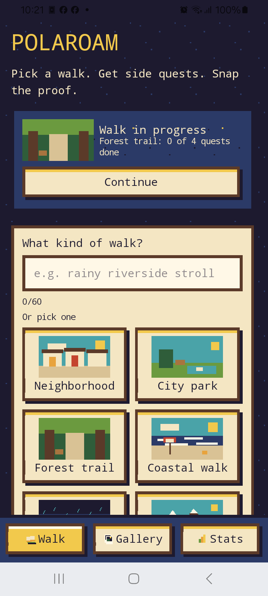
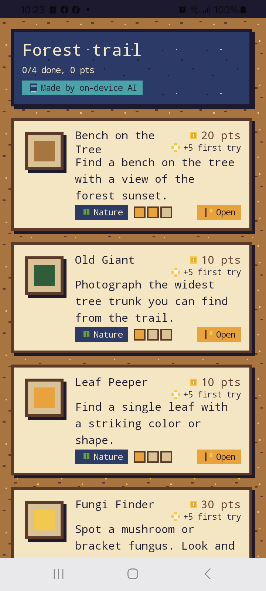
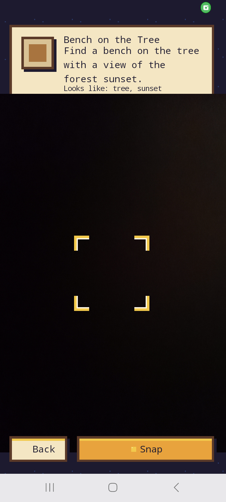
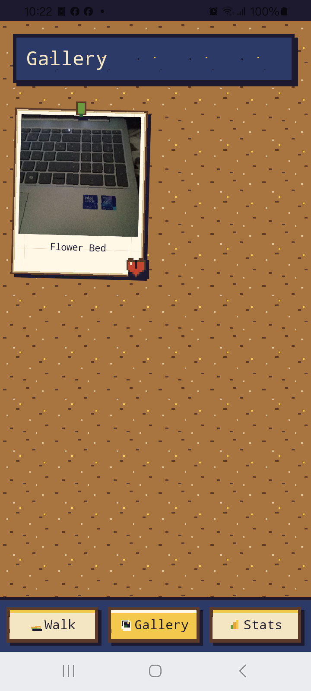
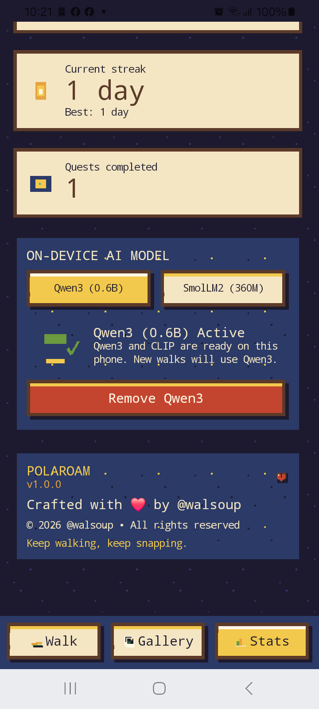

# Polaroam 📸

> An indie Android walking game with on-device AI side quests and instant photo checks.  
> **Crafted with ❤️ by [@walsoup](https://github.com/walsoup)** • Version **1.0.0**

Polaroam turns everyday walks into retro photo scavenger hunts. Pick a walk style (or type your own), get creative on-device AI side quests, snap what you find through a pixel viewfinder, and pin your developed Polaroids to your corkboard gallery.

---

## 📱 Screenshots

| Walk Setup | Quest Board | Camera Viewfinder | Polaroid Gallery | Stats & AI Config |
|:---:|:---:|:---:|:---:|:---:|
|  |  |  |  |  |
| *Pick presets or custom walks* | *AI-generated side quests* | *Viewfinder with pixel reticle* | *Corkboard with Polaroids* | *Streak, score & @walsoup credits* |

---

## ✨ Features

- 🚶 **Curated & Custom Walks**: Choose from 7 themed presets (*Neighborhood, City park, Forest trail, Coastal walk, Rainy stroll, Mountain trail, Night walk*) or type whatever walk you're taking.
- 🎯 **On-Device AI Quests**: Generates 3–5 tailored photo objectives per walk with difficulty tiers (1–3 pips) and bonus points.
- 📷 **Pixel Camera Viewfinder**: Built with CameraX, featuring custom tactile haptics, gold pixel reticle corners, and instant on-device verification.
- 🖼️ **Corkboard Polaroid Gallery**: Verified photos develop into authentic retro Polaroids pinned to a textured corkboard, complete with handwritten titles and decorative pixel stickers.
- 🔥 **Streaks & Scoring**: 10, 20, or 30 base points per quest, plus a +5 first-try bonus. Completing one verified quest a day keeps your streak alive.
- 🔒 **100% Local-First & Private**: No accounts, no analytics, no cloud backends, and no GPS tracking. Your camera photos never leave your device.

---

## 🧠 Open-Source On-Device AI

Every AI component runs strictly on the phone.

| Role | Model | Size | Runtime |
| :--- | :--- | :--- | :--- |
| **Writing Quests** | [Qwen3-0.6B](https://huggingface.co/litert-community/Qwen3-0.6B) or [SmolLM2-360M](https://huggingface.co/HuggingFaceTB/SmolLM2-360M-Instruct) | ~360MB–450MB | [Google LiteRT-LM](https://github.com/google-ai-edge/LiteRT-LM) |
| **Checking Photos** | [CLIP ViT-B/32](https://huggingface.co/openai/clip-vit-base-patch32) | ~30MB | [Microsoft ONNX Runtime](https://github.com/microsoft/onnxruntime) |

- **Dual-Model Switching**: Switch between **Qwen3 (0.6B)** and ultra-lightweight **SmolLM2 (360M)** with interactive chips in the Stats screen.
- **Constrained JSON Schema**: The LLM output is strictly bounded to a JSON schema, ensuring safety and selecting target concepts only from allowed vocabulary nouns.
- **Zero-Shot Semantic Verification**: Photos are transformed into 512-dimensional embeddings via MobileCLIP and compared against precomputed vocabulary vectors using scaled cosine similarity. Target probabilities pool together so related concepts (e.g. *tree* + *forest*) pass reliably.
- **Safety First**: Quests strictly forbid requests for photos of people/faces, private property/trespassing, roads/traffic, purchases, or dangerous night activities.

---

## 🛠️ Building & Testing

### Requirements
- Android SDK 35 (minSdk 26)
- Java 17+
- Android Studio Ladybug / Meerkat or `./gradlew` CLI

### Quick Start
```bash
# Clone the repository
git clone https://github.com/walsoup/roamshot.git
cd roamshot

# Run all unit tests (152+ tests)
./gradlew testDebugUnitTest

# Build debug APK
./gradlew assembleDebug

# Install to connected device
adb install -r app/build/outputs/apk/debug/app-debug.apk
```

### Configuration Flags (`local.properties`)
```properties
# Set to true for mock AI (useful for rapid UI testing without model downloads)
polaroam.stubAi=false

# Optional custom model endpoints
polaroam.modelUrl=https://example.com/custom-model.litertlm
polaroam.modelSha256=<sha256>
polaroam.visionModelUrl=https://example.com/custom-clip.onnx
polaroam.visionModelSha256=<sha256>
```

---

## 📦 Project Structure

```
roamshot/
├── app/
│   ├── src/main/java/app/polaroam/
│   │   ├── ai/               # LiteRT-LM, CLIP, prompt building & safety filters
│   │   ├── data/             # Room database, DAO, entities & repositories
│   │   ├── domain/           # Models, scoring, streaks & business logic
│   │   └── ui/               # Pure Compose UI: Home, Board, Capture, Gallery, Stats
│   └── src/main/res/         # Custom pixel assets, retro palette, and themes
├── design/                   # Pixel art generators, spritesheets, and design palette
├── docs/screenshots/         # On-device app screenshots
└── tools/clip/               # Zero-shot CLIP label embedding builder script
```

---

## 📜 License & Credits

- **Developer**: Crafted with ❤️ by [@walsoup](https://github.com/walsoup) (Walid Elonok).
- **Copyright**: © 2026 @walsoup • All rights reserved.
- **Models**: [Qwen3](https://huggingface.co/litert-community/Qwen3-0.6B) (Apache-2.0), [SmolLM2](https://huggingface.co/HuggingFaceTB/SmolLM2-360M-Instruct) (Apache-2.0), [CLIP](https://huggingface.co/openai/clip-vit-base-patch32) (MIT).
